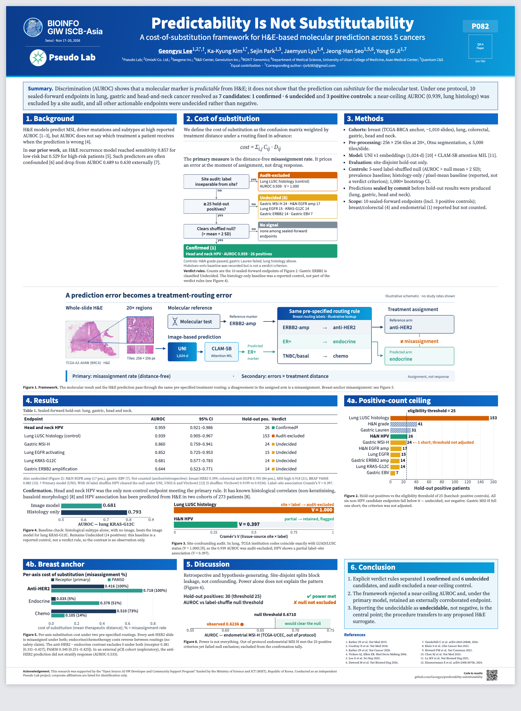

# GIW / ISCB-Asia 2026 poster (P082)

- `GIW2026_P082_poster.pdf` — poster, 90 × 120 cm
- `GIW2026_P082_preview.png` — preview image
- `figures/` — individual figures

| Figure | File |
|---|---|
| 1. Framework | `figures/fig1_framework.svg` |
| 2. Power ceiling | `figures/fig2_power_ceiling.svg` |
| 3. Site-confounding audit | `figures/fig3_site_audit.svg` |
| 4. KRAS-G12C baseline | `figures/fig4_kras_baseline.svg` |
| 5. Breast routing | `figures/fig5_breast_routing.svg` |
| 6. Endometrial MSI-H | `figures/fig6_ucec.svg` |
| Verdict rules | `figures/verdict_rules.svg` |

Figure 1 uses a TCGA-BRCA slide (TCGA-A2-A04W) from the Digital Slide Archive as an illustration.
